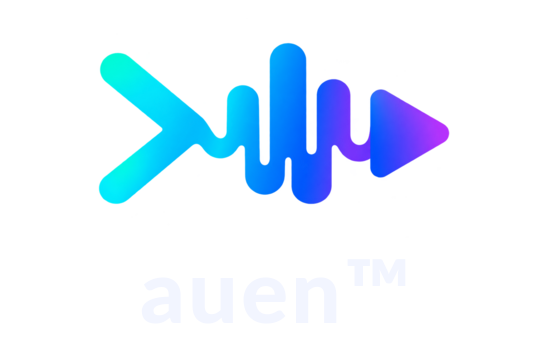
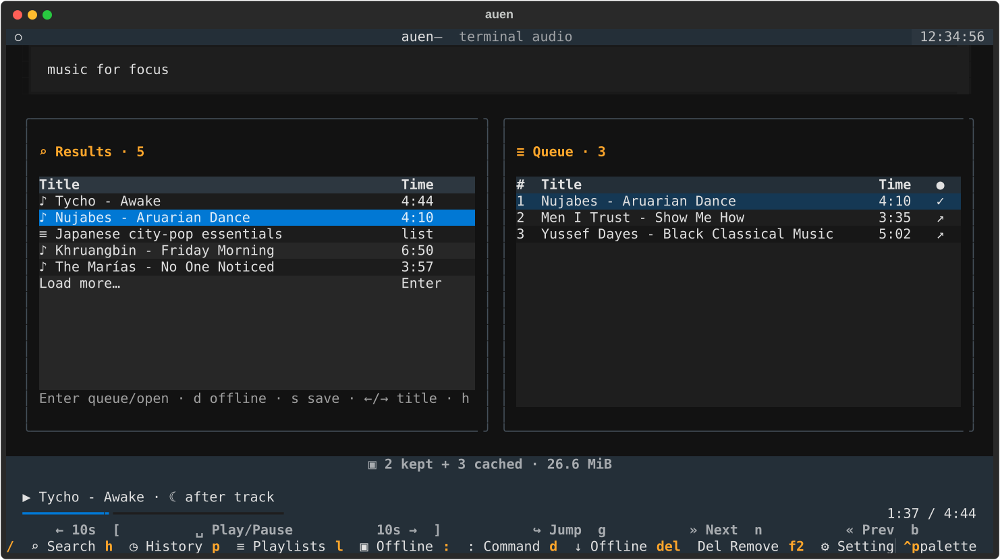
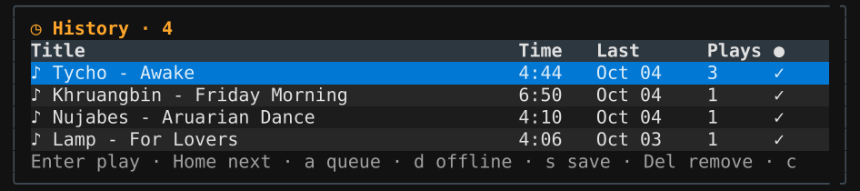
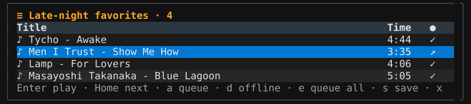
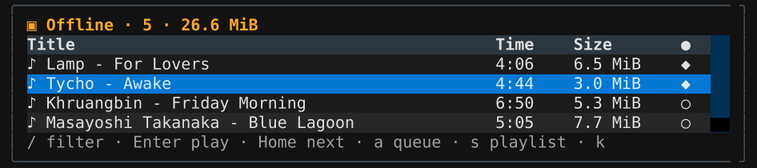
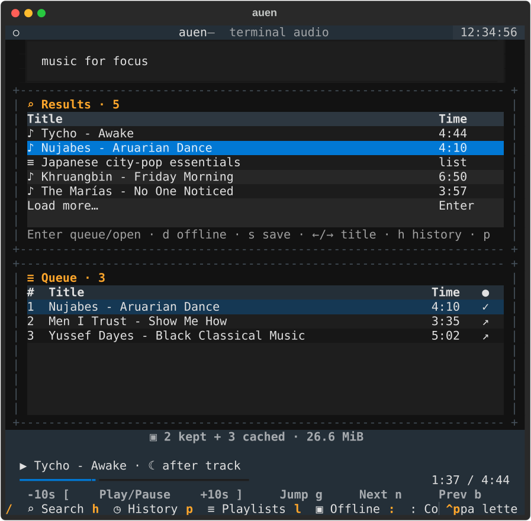
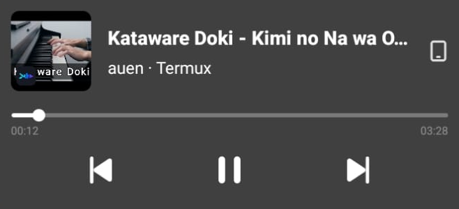
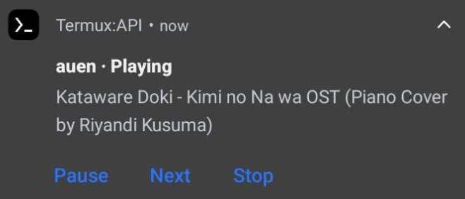

# auen

<p align="center">
  
</p>

`auen` is a keyboard-first terminal audio player for Linux, Windows, and Android/Termux. It uses a
full-screen Textual interface for YouTube search, queue management, streaming, and a
size-limited persistent playback cache.

> **Release — v1.2.0:** Previous-track navigation and optional keyboard/headset media controls
> on Linux, Windows, and Android/Termux. Core controls were tested by the user on Linux,
> Windows 11, and Android 13. Platform setup and remaining limitations are documented below.



Terminal previews are reproducible renders of the real TUI using sample data. The Android
media cards below are cropped screenshots from a physical device.

### Recently played

History keeps the most recent play time and play count while exposing the same play, queue,
offline, and playlist actions as the rest of auen.



### Named playlists

Saved playlists retain their ordering and duplicates. Tracks can be played immediately,
queued next, appended together, reordered, or saved into another playlist.



### Offline library

The local-only library shows duration, file size, and whether each track is retained (`◆`)
or belongs to the automatic size-limited cache (`○`).



### Termux layout

On phone-width terminals, Results and Queue stack vertically. Termux uses stable ASCII pane
borders while keeping playback, seeking, command mode, and the offline status strip visible.



### Background media controls

The optional Android companion provides lock-screen media controls, artwork, and a progress
slider without opening Termux. Headset buttons use the same playback actions.



Without the companion, optional Termux:API notifications provide Pause/Resume, Next, and
Stop. This fallback does not provide headset routing or a seek slider.



These screenshots are from Android 13; appearance and available controls vary by device.
See [Android setup](#install-on-android--termux) and the
[desktop media-control guide](docs/media-controls.md) for Linux and Windows integration.

## What works in v1.2.0

- Search YouTube and select tracks, albums, or playlists.
- Load more results explicitly without fetching merely by moving the cursor.
- Stream immediately or stream while retaining a managed offline copy.
- Play, pause, jump to a timestamp, seek by 10 seconds, and skip tracks with `mpv`.
- Press `b` to restart after three seconds, or return to the prior played track near the start.
  Previous follows actual playback order, including Shuffle, and preserves paused playback.
- Use optional Linux MPRIS or Windows media controls while the terminal is minimized.
  An optional Android companion adds headset controls, artwork, and media-session seeking.
- Add duplicate tracks with confirmation; play any queued row now or move its priority.
- Persist the queue, recently played tracks, cached media, settings, and playback position
  across restarts and crashes.
- Open Recently Played with `h`, including last-played timestamps and play counts; play now,
  play next, remove individual entries, or clear history with confirmation.
- Create, rename, delete, open, reorder, and play durable named playlists. Add tracks from
  search results, History, Queue, or another named playlist, or append a whole playlist to
  Queue in saved order.
- Export one or all named playlists as offline JSON track lists. Import either format;
  merge matching playlist names, skip existing sources, and append new tracks in order.
- See streaming, downloading, and offline availability directly in Queue, History, and an
  opened named playlist.
- Open Offline media with `l`; filter locally without a network connection, inspect duration
  and size, play or queue cached tracks, retain or release automatic cache entries, delete
  managed media safely, and inspect cache usage and download activity.
- Pace anonymous YouTube operations across search, streaming, and downloads. A bot challenge
  or HTTP 429 starts a short fail-fast cooldown shown in the Offline strip, while cached and
  local playback remain available.
- Get compact, view-specific key guidance at the bottom of the focused Results or Queue pane.
- Preview and save themes, with an adaptive side-by-side or stacked phone-width layout.
- Configure behavior through the TUI or scriptable `auen config` commands.
- Open compact command mode with `:` for sleep timers, navigation, settings, themes, help,
  and clean quitting. Duration timers pause in place; `sleep track` holds the remaining Queue.
- Control a running instance through a private local socket. On Termux, optional notification
  actions provide Pause/Resume, Next, and Stop without replacing mpv as the audio backend.

Version 1.0 established the current controls, persistent data, and Linux/Termux workflows as
auen's stable core. Future features will continue to be guided by real usage. auen deliberately
does not use Google-account cookies, so videos or networks that require authenticated YouTube
access may be unavailable. Request pacing can reduce bursts, but it cannot bypass a YouTube IP
or account challenge.

## Requirements

- Python 3.10 or newer; **Python 3.14 recommended on Windows** for the optional media-control
  packages (the pinned PyWinRT release has no Python 3.15 wheels)
- Linux or Windows with `mpv`, or Android with Termux and its `mpv` package
- Network access for YouTube search and streaming

`pipx` is recommended on Linux and Windows because it isolates Python dependencies and
provides the normal `auen` command. mpv is installed separately; the wheel does not bundle it.
The `[linux]` and `[windows]` extras enable optional desktop integration, not audio playback.
Download packages from the [v1.2.0 release](https://github.com/razorvel/auen/releases/tag/v1.2.0).

## Install on Linux

Install the system playback backend first. For Debian and Ubuntu:

```console
sudo apt install mpv pipx
pipx ensurepath
```

Download `auen-1.2.0-py3-none-any.whl`, open a terminal in that folder, then install with
optional desktop media controls:

```console
pipx install './auen-1.2.0-py3-none-any.whl[linux]'
auen --version
auen doctor
auen
```

Open a new terminal if `auen` is not found after `pipx ensurepath`. Omit `[linux]` for just
the player. Desktop environments may route media keys automatically; i3 needs explicit
[universal playerctl bindings](docs/media-controls.md#linux-desktop-media-controls).
Installing the extra alone does not configure hardware routing.

Alternatively, install tagged GitHub source (requires Git):

```console
pipx install 'auen[linux] @ git+https://github.com/razorvel/auen.git@v1.2.0'
```

For a checked-out source tree, use `pipx install '.[linux]'`. A regular virtual environment
also works:

```console
python3 -m venv .venv
. .venv/bin/activate
python -m pip install '.[linux]'
auen doctor
auen
```

## Install on Windows

Use Windows Terminal and **CPython 3.14** for the tested media-control setup. Install a Windows
mpv build listed on the [mpv installation page](https://mpv.io/installation/); `mpv --version`
must work in the same terminal. Both `mpv.exe` and `mpv.com` are recognized.

Download `auen-1.2.0-py3-none-any.whl` and open PowerShell in its folder. If needed, install
Python 3.14 using the [Python Install Manager](https://www.python.org/downloads/windows/)
(`py install 3.14`), or install CPython 3.14 separately. Confirm `py -3.14 --version`, then:

```powershell
py -3.14 -m pip install --user --upgrade pipx
py -3.14 -m pipx install --force --python 3.14 ".\auen-1.2.0-py3-none-any.whl[windows]"
py -3.14 -m pipx ensurepath --prepend --force
```

Fully close Windows Terminal and reopen it so its PATH refreshes. Then use plain `auen`:

```powershell
where.exe auen
auen --version
auen doctor
auen
```

Expect `auen 1.2.0`, Python 3.14, mpv available, and Windows media-control dependencies `[ok]`.
If another Python's `auen` takes precedence, inspect `where.exe auen` first. An old pipx
environment may need `py -3.14 -m pipx reinstall auen --python 3.14`. Do not uninstall unrelated
Python apps. The pinned PyWinRT packages support CPython through 3.14, not 3.15;
[available wheels](https://pypi.org/project/winrt-Windows.Media.Interop/#files).

Without pipx, create a virtual environment and run its launcher directly:

```powershell
py -3.14 -m venv .venv
.\.venv\Scripts\python.exe -m pip install ".\auen-1.2.0-py3-none-any.whl[windows]"
.\.venv\Scripts\auen.exe doctor
.\.venv\Scripts\auen.exe
```

With `[windows]`, auen registers a native media card; look above Quick Settings (**Win+A**
on Windows 11) while a track plays. Media keys/headset gestures are routed by Windows.
Omit the extra to keep ordinary terminal playback without native media controls.
No Android APK, SDK, or administrator rights are required for this integration.

Playback uses mpv's Windows named pipe. Remote commands use an authenticated loopback-only
connection on Windows and private Unix sockets on Linux/Termux. Settings, state, and caches
use the operating system's user directories.

The [Windows validation checklist](docs/windows-testing.md) covers installation, playback,
remote control, persistence, rendering, and playlist transfer. The automated test workflow
includes Windows and Linux, plus a native mpv IPC check that does not require a sound device.

## Install on Android / Termux

Install [Termux](https://github.com/termux/termux-app#installation), then run:

```console
pkg update
pkg upgrade
pkg install python git mpv ffmpeg
python -m pip install 'git+https://github.com/razorvel/auen.git@v1.2.0'
auen --version
auen doctor
auen
```

mpv is selected automatically and provides seeking, direct streaming, volume control, and
precise position reporting. Termux:API is not required when mpv is installed.
Upgrade all Termux packages together: partial upgrades can cause ffmpeg/mpv library-linking
errors. Do not upgrade Termux's pip using pip itself.

Alternatively, install the downloaded wheel with
`python -m pip install ~/downloads/auen-1.2.0-py3-none-any.whl` (adjust its location).
Use normal dependency resolution, not `--no-deps`, for a fresh installation.

Optional Android notification controls require the
[Termux:API companion app](https://github.com/termux/termux-api#installation) from the same
source as Termux, then install its command package:

```console
pkg install termux-api
```

Termux and Termux:API must come from the same source because their signatures must
match. auen continues to use mpv for audio; Termux:API is used only to display an ongoing
notification with Pause/Resume, Next, and Stop actions. Disable it through **Android playback
notification** in Settings or `auen config set android.notification false`.

For **TWS/headset buttons and Android's media progress slider**, install the separate optional
`auen-media-controls-0.6.0-prototype.apk`, then enable **Android headphone controls (APK)**
in F2. It connects automatically, shows artwork, and stays ready while idle. See the
[companion setup and build instructions](android/README.md), including manual connection,
permissions, signing, and troubleshooting. This release reuses that tested APK unchanged;
its version is independent of Python auen 1.2.0. It remains a test-signed prototype.
The auen companion is a separate app and does not need to share Termux's signing certificate.

The APK is not required for auen playback. If absent or disconnected, audio continues;
Termux:API notification controls return when enabled. Android controls which media layouts
expose seeking and may restrict background startup or lock-screen actions.

The same private local control channel is available from another Termux session:

```console
auen remote status
auen remote toggle
auen remote previous
auen remote next
auen remote stop
```

`stop` cleanly exits the running auen instance. Missing or unresponsive notification support
never interrupts playback, and the local control socket is accessible only to the current
Termux/Linux user.

The real-device test sequence and expected limitations are recorded in
[`docs/termux-testing.md`](docs/termux-testing.md).

## Updating and media-control limits

For pipx, install a newer downloaded wheel with `pipx install --force '<wheel-path>[linux]'`
or the Windows Python-3.14-pinned command above with `[windows]`. `pipx install --upgrade`
is not valid; replacing a local wheel uses `--force`. On Termux, use
`python -m pip install --upgrade <wheel-path>`. Existing settings, playlists, History, and
managed offline media remain in their user-data directories; do not delete them to update.

Linux and Windows hardware **Stop** stops playback but keeps auen open; Play restarts the
retained track. **`auen remote stop` and Android notification Stop quit auen**.
Only one auen instance may use a given state directory at a time.

Core media controls passed user tests on Linux, Windows 11/CPython 3.14, and Itel RS4/Android 13.
Windows seeking and hardware Stop remain physically unverified: the tested card exposed no
seek slider. Other Android devices, calls/audio-focus interactions, and manufacturer battery
limits need further testing. Missing optional integration must not prevent ordinary playback.
See [platform media controls](docs/media-controls.md) for routing and diagnostic details.

## Essential controls

| Key | Action |
| --- | --- |
| `/` | Focus search |
| `Tab` / `Shift+Tab` | Switch between Results and Queue |
| `Enter` | Open a collection, queue a result, or play a queued row now |
| `Esc` | Leave search or return from a collection |
| `Space` | Play or pause |
| `[` / `]` | Seek backward or forward 10 seconds |
| `g` | Jump to a timestamp |
| `n` | Play next track |
| `b` | Restart after 3 seconds; near the start, return to the previous played track |
| `h` | Open or leave Recently Played |
| `p` | Open or leave named Playlists |
| `l` | Open or leave Offline media |
| `:` | Open command mode |
| `s` | Save the selected track to a named playlist |
| `e` | Append every track in the currently open named playlist to Queue |
| `d` | Retain the selected result for offline playback |
| `Home` | Promote the selected queued track to play next |
| `Shift+Up` / `Shift+Down` | Change queue priority |
| `Delete` | Remove the selected queued track |
| `F2` | Open Settings |
| `F3` | Preview and select a theme |
| `q` | Quit and stop playback |

In Recently Played, Enter plays the selected track now, Home places it next, `a` appends it
to Queue, Delete removes one entry, `c` clears all history after confirmation, and Escape
returns to the exact prior Results view.

In Playlists, `c` creates, `r` renames, Delete removes with confirmation, and Enter opens a
playlist. Inside one, Enter plays now, Home plays next, `a` appends to Queue,
`e` confirms and appends the entire playlist, Shift+Up/Down reorders, Delete removes a
track, and Escape returns to the playlist list.

### Offline playlist import and export

In the playlist list, press `x`, then choose **Selected playlist** or **All playlists** in
the export dialog. `x` also works inside an opened playlist. Enter a destination file path;
Escape cancels. **All playlists** puts every named playlist, including empty playlists,
into one file. Press `i` to import either a single-playlist file or a multi-playlist bundle.
Exports use a versioned UTF-8 JSON format and refuse to overwrite existing files.

The CLI provides the same operations, including an optional imported name:

```console
auen playlist list
auen playlist export "Favorites" favorites.auen.json
auen playlist export --all auen-playlists.auen.json
auen playlist import favorites.auen.json
auen playlist import auen-playlists.auen.json
auen playlist import favorites.auen.json --name "Travel"
```

Export preserves track order, duplicates, titles, sources, and durations. A new playlist
imports them in the saved order. If the name already exists, import merges into that
playlist: existing rows remain unchanged, matching sources are skipped, and new sources
are appended in file order. Alternate YouTube links to the same video count as the same
source, even when their titles differ. Tracks with identical titles but different YouTube
video IDs remain distinct. The result reports how many tracks were added and skipped.

These operations require no network connection. Audio files are **not** included. Imported
tracks can play offline when their media is already available in auen's local cache; local
file entries keep their original paths, which must exist on the destination device. Otherwise
YouTube tracks require streaming or a separate download. Cache paths, transient streaming
URLs, and internal identifiers are omitted from exports. Invalid imports leave existing
playlists unchanged. Bundle import validates every playlist before writing and applies the
entire bundle in one transaction. `--name` is available only for files containing exactly
one playlist.

Availability symbols are consistent across Queue, Recently Played, and opened playlists:
`✓` is available offline, `↓` is downloading, and `↗` will stream.

In Offline media, `◆` is explicitly retained and `○` is an automatic cache entry eligible
for size-based eviction. `/` focuses a title filter that works entirely from the local cache.
Enter plays now, Home plays next, `a` appends to Queue, `s` saves to a named playlist, `k`
switches between retained and bounded cache, Delete removes the managed media file after
confirmation, and Escape restores the prior Results view. Older cached entries show an
unknown duration until first playback; mpv then discovers and saves it locally.

Left and Right page through a long selected title. Leaving that row restores its title to
the beginning. Playback seeking deliberately uses `[` and `]`, so arrow keys remain safe
for tables and text fields.

### Command mode and sleep timers

Press `:` while Results or Queue is focused, type a command, and press Enter. Escape closes
the command field without running anything. Search continues to accept `:` as ordinary text.

| Command | Action |
| --- | --- |
| `sleep 30` | Pause playback in 30 minutes |
| `sleep 1h 20m` | Pause after a combined duration |
| `sleep 1:30` | Pause in 1 hour 30 minutes |
| `sleep at 23:30` | Pause at the next occurrence of that local time |
| `sleep track` | Finish the current track, then hold Queue playback |
| `sleep` | Show the active timer |
| `sleep cancel` | Cancel the active timer |
| `library`, `history`, `playlists` | Open that view |
| `settings`, `theme` | Open that screen |
| `help`, `quit` | Show command help or quit auen |

An active timer appears beside Now Playing. Duration timers pause the current track in place;
Space resumes it. After-track timers preserve the remaining Queue, and Space starts its next
track. Sleep timers intentionally do not survive quitting and restarting auen.

Some terminals disagree with Textual about the rendered width of shaped Indic scripts,
which can corrupt adjacent columns. auen transliterates only those script runs in table and
Now Playing display text; the original Unicode title remains unchanged in searches, saved
state, playlists, and playback metadata.

## Settings from the terminal

```console
auen config list
auen config get cache.max_size
auen config set cache.max_size 1.5GB
auen config set session.mode stream_and_cache
auen config set history.limit 500
auen config reset playback.volume
```

Preferences are stored in the platform configuration directory. Queue and recovery data
use a separate transactional SQLite database. Run `auen doctor` whenever installation or
backend setup is unclear.

## Develop and build

```console
python3 -m venv .venv
. .venv/bin/activate
python -m pip install -e '.[dev]'
make check
make build
```

`make check` runs the test suite with a safety timeout, linting, and strict type checking.
`make build` creates a wheel and source archive in `dist/`. The product baseline and
future requirements are in [`docs/requirements.md`](docs/requirements.md).
`make previews` regenerates the README SVGs from real headless TUI views using temporary
sample data, with no network calls or actual playback. No media-card hardware is simulated.

## License

auen is available under the [MIT License](LICENSE).
